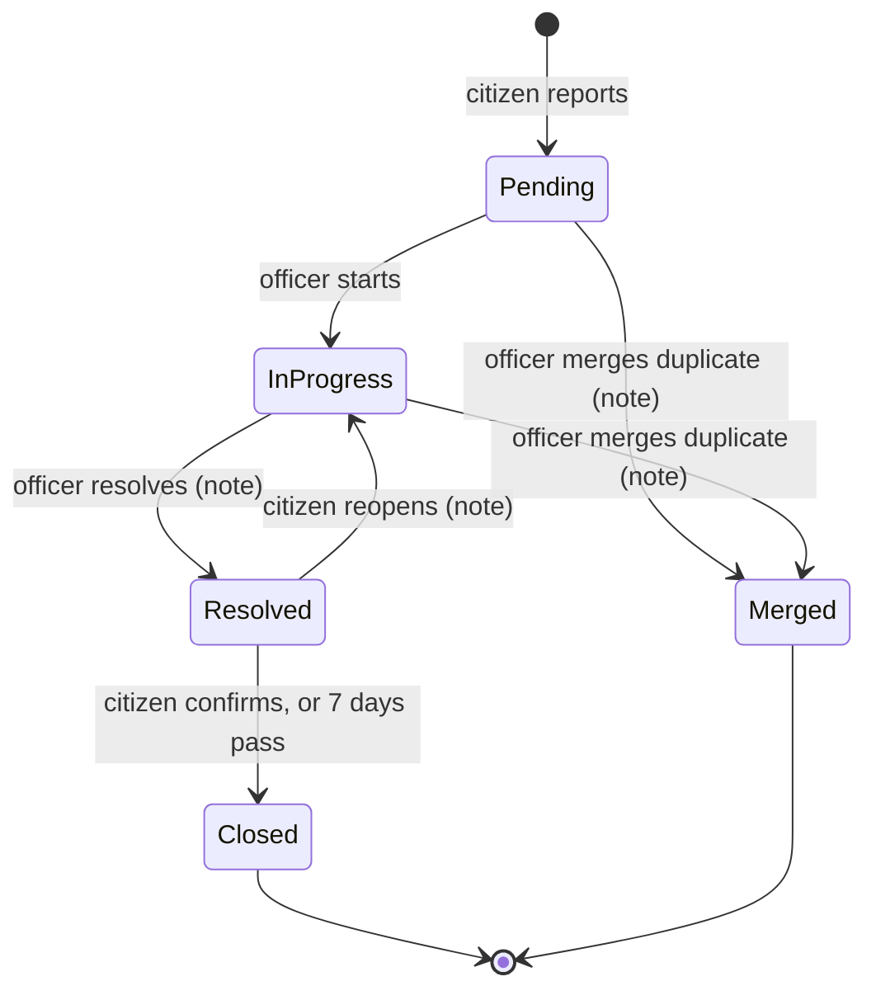
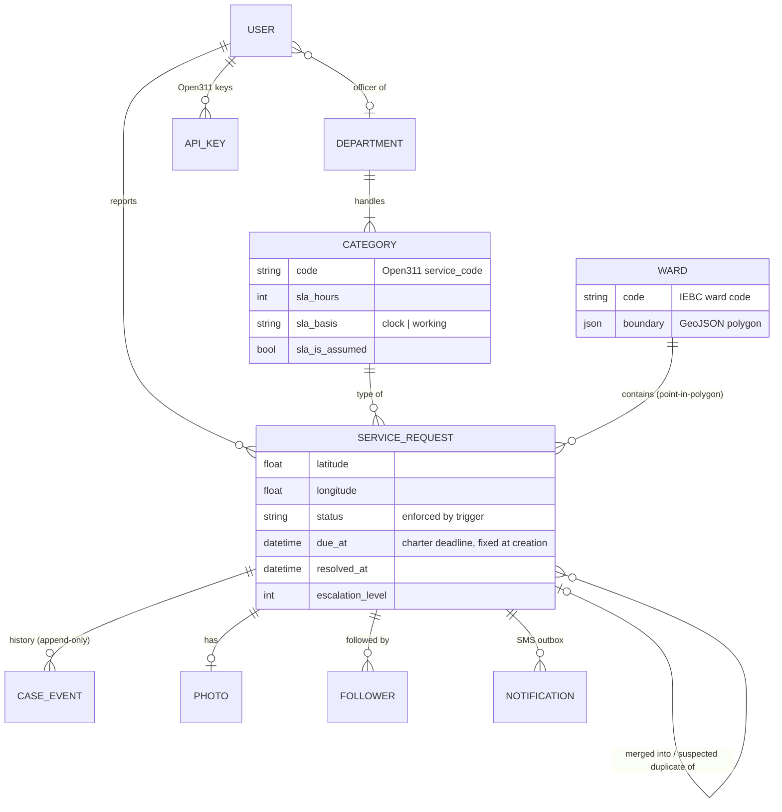

# Murang'a Service Requests

Citizens of Murang'a County report broken streetlights, water leaks, potholes and missed
garbage collection, then follow each report from **Pending → In progress → Resolved → Closed**.
County officers work a queue sorted by charter deadline, and administrators see how the county
is doing against those deadlines, ward by ward.

The brief asked for six features. This version adds none beyond them, and instead tries to do
each one the way a county operation would need it:

| Feature | What "done properly" means here |
|---|---|
| Registration / login | Phone-number accounts (the number the county texts), three roles, lockout after 5 failed sign-ins. **Tests prove no citizen can read another's report** over any URL. |
| Submit a request | Pin on a map, use GPS, or pick a ward (for people who can't use a map). **Auto-routed to a ward** (point-in-polygon with shapely) using IEBC boundaries chosen by measurement. **Duplicates within 100 m are offered before the citizen writes anything**, and officers can merge them. Photos are re-encoded with **GPS EXIF removed**. |
| Status tracking | An **enforced state machine**: the service layer *and* a database trigger reject illegal moves. **Append-only history** (a trigger blocks edits and deletes). The citizen, not the officer, confirms a fix, or reopens it. |
| Admin dashboard | Queue per department, ordered by **deadline from the MUWASCO charter** (in working hours, skipping public holidays). Overdue cases highlighted and **escalated** by SMS. |
| Analytics | Open vs resolved, plus **median time to resolve, deadline breach rate and backlog age**, by ward and category, **reconstructable for any past date** from the history. |
| SMS | Africa's Talking (sandbox), sent from an outbox after commit, retried on failure, with no personal details in the text. |

**Live demo:** _add your Vercel URL here_ · **API:** Open311 GeoReport v2 at `/open311/v2/`

---

## Run it (3 commands)

Needs Docker Desktop.

```bash
git clone <this repository> muranga-service-requests && cd muranga-service-requests
cp .env.example .env
docker compose up --build
```

Open http://localhost:8000. The first start downloads the IEBC ward boundaries (~19 MB) and replays
3,654 real complaints in the background, which takes a few minutes.

**Demo accounts** (password: `DEMO_PASSWORD` in `.env`, default `Murang-a-demo-2026`):

| Phone | Role |
|---|---|
| 0700 000 001, 0700 000 002 | Citizens |
| 0700 000 010 / 011 / 012 | Officers: Water (MUWASCO) / Roads / Environment |
| 0700 000 099 | County administrator (also the Django admin at `/django-admin/`) |

To send real sandbox SMS, put an Africa's Talking sandbox API key in `AT_API_KEY`. Without one,
messages are logged and marked "skipped".

## Tests

```bash
docker compose run --rm web pytest
```

That runs 132 tests against the compose PostgreSQL database. Run plain `pytest` outside Docker and the
suite starts its own PostgreSQL through **Testcontainers**.

* `test_state_machine.py`: **property-based** (Hypothesis): random sequences of actions by six kinds
  of actor, with invariants checked after every step; plus the database trigger checked against
  all 20 status pairs. A deliberately broken role check was caught (see *Evidence*).
* `test_access.py`: every way to reach a case, for every kind of visitor.
* `test_geo.py`: known places → expected wards; constituency agreement with an independent map;
  duplicate radius, window, category and status rules.
* `test_deadlines.py`: worked examples, including Mashujaa Day, plus a property test against a
  brute-force minute counter.
* `test_photos.py`, `test_open311.py`, `test_notifications.py`, `test_analytics.py`, `test_flows.py`.

## Evidence that it works

Each item below was checked by something other than the code under test, or by anyone reading this.

| Claim | Checked by | Result | Reproduce |
|---|---|---|---|
| Dashboard numbers are right | An **independent re-implementation** (pandas + shapely, no Django) computing every figure from the raw CSV | **All 434 figures identical** at 3 snapshot dates; a single corrupted figure is detected | `docs/evidence/analytics_*.json`; CI job `replay` |
| Speaks Open311 | **Code for America's `open311` client** (unmodified) lists services, posts, reads back, filters | Passes in XML; two bugs found *in the client* (JSON mode) | `docs/evidence/open311_client_check.txt`, `scripts/open311_client_check.py` |
| Ward routing is right | Four boundary files scored against **IEBC constituencies** and the **GeoNames gazetteer** | IEBC 2012 best (92.4% / 90.5%); the first choice (GADM) would have misrouted ~1 in 7 | `docs/boundaries.md`, `docs/evidence/ward_source_comparison.txt` |
| Known coordinates → wards | `data/known_points.csv`, built by a fixed rule from GeoNames | 8/9 pass; the 9th is outside its ward in all four boundary files (gazetteer error, kept as `xfail`) | `tests/test_geo.py` |
| Tests catch real bugs | **Mutation check**: officers allowed in any department | Property test failed at once with a minimal example | `docs/evidence/README.md` |
| Accessible | **axe-core**, WCAG 2.2 A/AA rules, 13 pages × 2 screen sizes × 4 roles | See `docs/evidence/axe_results.json` | `sh scripts/audit.sh` |
| Usable on 3G | **Lighthouse**, phone, 400 kbps / 400 ms / 4× CPU | See `docs/evidence/lighthouse/` | `sh scripts/audit.sh` |
| No obvious security holes | **OWASP ZAP baseline** | 0 failures; each warning fixed or justified in `zap-rules.tsv` | `docs/evidence/zap/` |
| SMS reaches a phone | Africa's Talking **sandbox simulator** | _Pending: needs your sandbox key_ | `docs/evidence/README.md` |
| Real people can use it | **5-person usability test** | _Pending: script and template ready_ | `docs/usability/` |

`docs/evidence/README.md` describes each run, including what failed along the way and was fixed.

## How it works

### Case lifecycle



The table in `requests_app/statemachine.py` is the only definition. `services.transition()` enforces it
for the app, and a PostgreSQL trigger generated from the same table enforces it for everything else.

### Data model



### Layout

```
accounts/        phone-number users, roles, sign-in
requests_app/    the domain: models, statemachine, services, deadlines, geo, analytics,
                 notifications, photos, access rules, views, management commands
open311/         GeoReport v2 API and API keys
templates/ static/   server-rendered pages, one stylesheet, one small script, vendored Leaflet
data/            raw sources (unchanged), categories + charter targets, replay rules, known points
scripts/         independent checks: verify_analytics, compare_ward_sources, a11y, audit, Open311 client
tests/           pytest suite
docs/            decisions, metrics, boundaries, replay, threat model, ASVS, accessibility, usability, evidence
```

## Data sources

| What | Source | Licence / note |
|---|---|---|
| Ward boundaries | IEBC via HDX ("Kenya Admin Boundaries – Election Polling stations") | Downloaded at setup, not redistributed |
| Constituency boundaries (check only) | IEBC via HDX "Kenya – Subnational Administrative Boundaries" | CC BY-IGO, in `data/boundaries/` |
| Water deadlines | [MUWASCO customer service charter](https://muwasco.co.ke/services.html), copy saved in `data/raw/` | Quoted in `data/categories.json` |
| Other deadlines | **Assumed**: no published county targets found | Marked as assumptions in the UI |
| Complaint data | [NYC 311](https://data.cityofnewyork.us/Social-Services/311-Service-Requests-from-2010-to-Present/erm2-nwe9), 1–7 March 2025 | NYC Open Data, unrestricted |
| Place names (check only) | [GeoNames](https://www.geonames.org/) Kenya extract | CC BY 4.0 |
| Public holidays | `holidays` Python package | MIT |

## Decisions and limitations

The full reasoning is in [`docs/decisions.md`](docs/decisions.md). The main trade-offs:

* **Server-rendered Django, not a SPA**: pages of about 5 KB that work without JavaScript, for 3G and
  cheap phones.
* **Five statuses, not four**: *Merged* is terminal and excluded from the figures, so duplicates are
  never counted twice and their reporters aren't lost.
* **Deadlines never move**: a reopened case keeps its original deadline.

**Known limitations**

* No phone verification at registration, and no password reset (both need SMS one-time codes):
  ASVS gaps 2.5 and 2.7 in [`docs/asvs-l1.md`](docs/asvs-l1.md).
* English only.
* Deadlines for roads, lighting and waste are assumptions until the county publishes targets.
* All water cases go to MUWASCO, whose service area may not cover the whole county.
* Ward boundaries date from 2012, and around 1 in 10 gazetteer places disagree with the 2019
  constituency map. A report near a ward border may land in the neighbouring ward's queue.
* Replay locations are NYC's geography mapped onto Murang'a, so ward breakdowns of replay data are
  illustrative.
* On Vercel's free (Hobby) plan the escalation job runs once a day, not every 15 minutes.

Security: [threat model (STRIDE)](docs/threat-model.md) · [OWASP ASVS L1 check](docs/asvs-l1.md).
Accessibility: [WCAG 2.2 notes](docs/accessibility.md).

## Deploy (Vercel)

Vercel runs the website; the database is a free Postgres from **Neon**, added through Vercel.

1. On [vercel.com](https://vercel.com), sign in with GitHub. Choose **Add New → Project**, import
   this repository, and click **Deploy**. (The first deploy shows an error page until step 3 is done.)
2. In the project, open **Storage → Create Database → Neon (Postgres)**, then connect it to the
   project. Vercel adds `DATABASE_URL` to the project's settings.
3. Under **Settings → Environment Variables**, add `DJANGO_SECRET_KEY` (any long random text) and
   `CRON_SECRET` (any random text). Optionally add `AT_API_KEY` for SMS.
4. Copy the database's connection string (Storage → your database → **.env.local** tab →
   `DATABASE_URL`), then, on your computer, with Docker running:

   ```bash
   sh scripts/publish_db.sh "paste-the-connection-string-here"
   ```

   That builds the wards, categories, demo accounts and replayed reports locally and copies them to
   Neon. The demo accounts get the `DEMO_PASSWORD` from your local `.env`.
5. **Deployments → Redeploy**. Open the `….vercel.app` address and sign in.

To publish later code changes, push to GitHub (Vercel redeploys by itself). If a change adds
migrations, run `publish_db.sh` again.
